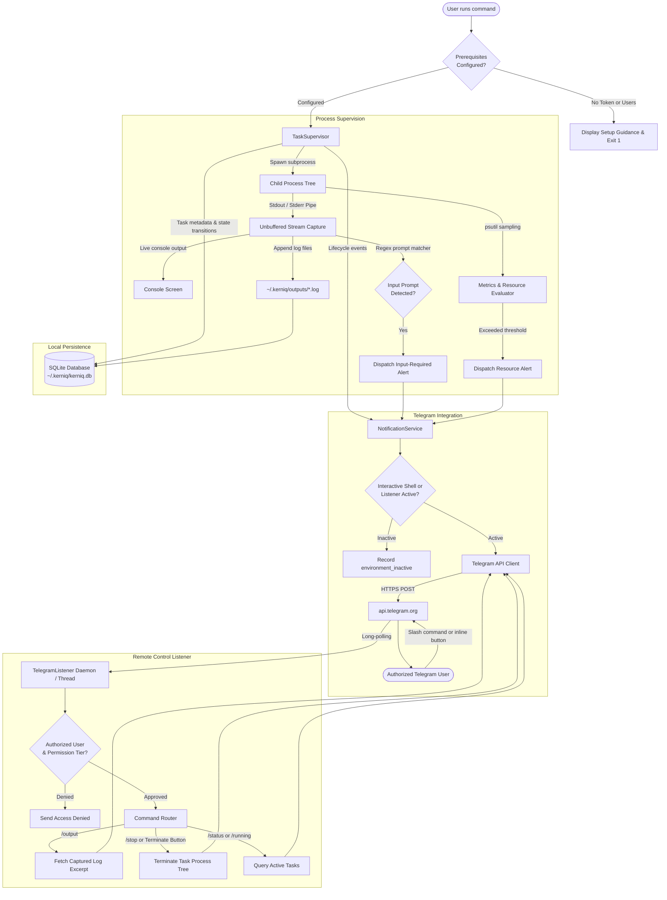
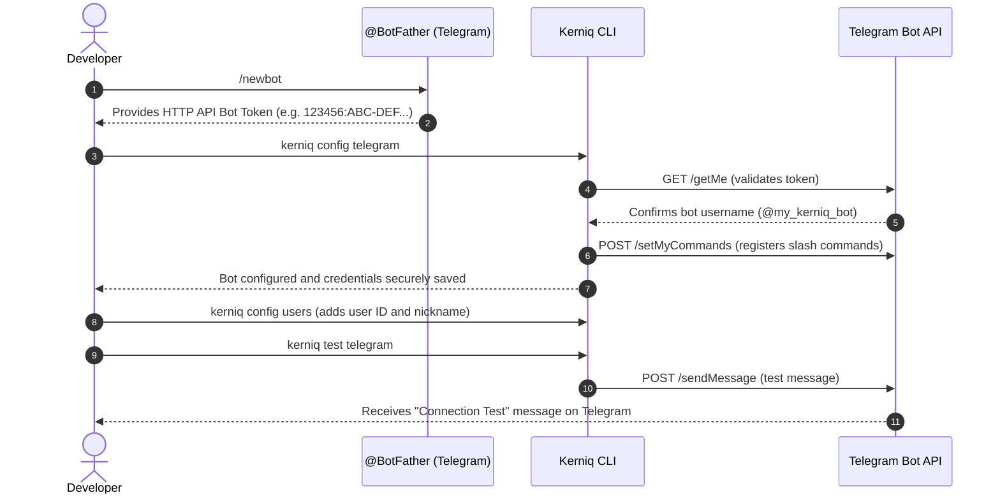
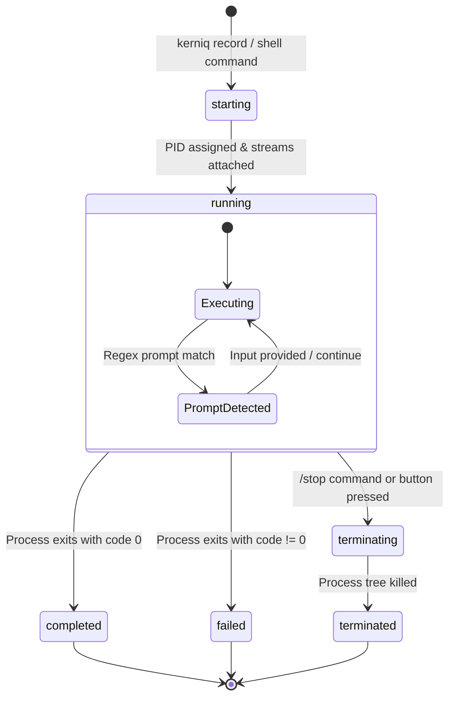

<h1 align="center">Kerniq</h1>

<h3 align="center">Don't babysit your terminal.</h3>

<p align="center">
  <em>Run your commands. Track their progress. Know when they finish.</em>
</p>

<p align="center">
  <a href="https://pypi.org/project/kerniq/"></a>
  <a href="https://pypi.org/project/kerniq/"></a>
  <a href="#telegram-bot-setup"></a>
  <a href="LICENSE"></a>
  <a href="#system-requirements"></a>
</p>

Developers, data scientists, and systems engineers frequently execute long-running commands in their terminals: test suites, model training routines, Docker builds, database migrations, and deployment scripts. Stepping away from the workstation often leads to lost time—returning to discover that a build crashed moments after you left, or that a script hung indefinitely waiting for an interactive confirmation prompt (`[y/N]`). Repeatedly alt-tabbing to check terminal progress breaks focus and derails developer flow.

**Kerniq** is a local-first terminal task monitoring utility engineered to eliminate terminal babysitting. Run any command through `kerniq record -- <command>` or work inside the persistent interactive `kerniq shell`. Kerniq wraps your process, captures standard output and error in real time without buffering delays, tracks the entire process hierarchy across child forks, samples CPU and memory consumption, detects interactive input prompts, and preserves an inspectable local record of execution events and exit codes.

With optional Telegram integration, Kerniq delivers instant, rich lifecycle alerts to your phone or desktop. If a task prompts for credentials, exceeds resource thresholds, or finishes running, you are alerted immediately. A lightweight background listener daemon lets you query task status, inspect output logs, review process trees, or safely terminate runaway jobs on demand—giving you complete visibility and control over your terminal tasks from anywhere.

---

## Key Features

- **Supervised Command Execution:** Wraps any CLI command, records start and end timestamps, tracks exact exit codes, and announces predictable numeric task IDs (`[KQ-1042]`) immediately at launch.
- **Live Output Streaming & Prompt Detection:** Streams stdout and stderr unbuffered to your screen while continuously scanning for interactive input prompts (`[y/N]`, `password:`, `enter token:`) to alert you when a task needs input.
- **Process-Tree & Child Fork Monitoring:** Discovers and monitors the entire process hierarchy—including parent processes and spawned child workers—preventing PID reuse and tracking multi-process workloads.
- **Hardware & Resource Consumption Metrics:** Samples per-process and system-level CPU percentage, RSS memory (in MB), and host battery level with configurable thresholds and alert cooldowns.
- **Task History & Captured Logs:** Preserves execution logs, exit codes, and timestamps locally in SQLite and dedicated log files (`~/.kerniq/outputs/`), with flexible search (`kerniq find`) and retention cleanup (`kerniq cleanup`).
- **Telegram Notifications & Remote Control:** Sends immediate alerts for task events and provides authorized Telegram slash commands (`/running`, `/report`, `/status`, `/output`, `/stop`) with interactive inline buttons.
- **Interactive Monitoring Shell:** Persistent terminal REPL (`kerniq shell`) that automatically supervises every executed command, with built-in controls for pause, resume, status, stop, history, and search.
- **Local Task & Activity Records:** Complete local-first architecture with SQLite database storage (`~/.kerniq/kerniq.db`) and timestamped operational activity logging (`kerniq logs`).
- **Diagnostics, Configuration & Export:** Built-in system health checks (`kerniq doctor --test`), interactive configuration wizards (`kerniq config`), and flexible report exports (`json`, `csv`, or `pdf`).

---

## Installation

Install the latest release of Kerniq from PyPI:

```bash
pip install kerniq
```

### Verification & Health Check

Verify that Kerniq is installed and check its version:

```bash
kerniq version
```

Run the built-in diagnostic doctor to verify dependencies, storage permissions, and configuration:

```bash
kerniq doctor
```

---

## Practical Usage Examples

### 1. View Allowed Commands and Options

Inspect the command reference directly in your terminal:

```bash
# View all allowed CLI commands
kerniq help

# View Telegram bot remote commands reference
kerniq help --telegram

# View interactive shell commands reference
kerniq help --shell
```

### 2. Supervise a Single Command

Wrap any terminal command with `kerniq record -- <command>`:

```bash
kerniq record -- python train.py
```

Kerniq immediately displays your task ID (`KQ-1042`), streams output in real time, samples resource usage, detects interactive prompts, and delivers Telegram notifications upon start and completion.

### 3. Check System & Subsystem Status

View a real-time status snapshot of running tasks, listener state, storage, and battery:

```bash
# Complete system snapshot
kerniq status

# Target specific subsystems
kerniq status --listener
kerniq status --telegram
kerniq status --rules
kerniq status --users
```

### 4. Inspect Task Output & Details

Inspect captured stdout and stderr logs, process trees, and metrics using the numeric task ID:

```bash
# View captured stdout and stderr logs
kerniq KQ-1042 --output

# View process hierarchy tree and child workers
kerniq KQ-1042 --tree

# View resource consumption (CPU %, Peak RAM) and process events
kerniq KQ-1042 --consumption --events

# Export task report to file (JSON, CSV, or PDF)
kerniq KQ-1042 --output --tree --export
```

### 5. Review Execution History

Review past task runs with formatted terminal dividers and start times:

```bash
# View recent task history
kerniq history

# Limit to the last 10 tasks
kerniq history --limit 10

# Export history report to disk
kerniq history --limit 10 --export
```

### 6. Work Inside the Interactive Shell

For multi-step workflows, launch the interactive shell where every command is monitored automatically:

```bash
kerniq shell
```

Inside the shell, you can run commands naturally or use built-in controls:
```text
kerniq> pytest tests/
kerniq> KQ-1042 --output
kerniq> status
kerniq> history --limit 5
kerniq> exit
```

> **Telegram Notifications & Remote Control:** To receive alerts and control tasks from your phone or desktop, follow the step-by-step [Telegram Bot Setup](#telegram-bot-setup) guide below.

---

## Table of Contents

- [How Kerniq Works](#how-kerniq-works)
- [Architecture](#architecture)
- [System Requirements](#system-requirements)
- [Telegram Bot Setup](#telegram-bot-setup)
  - [Step 1: Create a Bot with BotFather](#step-1-create-a-bot-with-botfather)
  - [Step 2: Obtain Your Numeric Telegram User ID](#step-2-obtain-your-numeric-telegram-user-id)
  - [Step 3: Configure Telegram in Kerniq](#step-3-configure-telegram-in-kerniq)
  - [Step 4: Authorize Telegram Users](#step-4-authorize-telegram-users)
  - [Step 5: Test the Integration](#step-5-test-the-integration)
  - [Step 6: Start the Persistent Listener](#step-6-start-the-persistent-listener)
- [CLI Command Reference](#cli-command-reference)
  - [Allowed Commands Summary](#allowed-commands-summary)
  - [Detailed Command Breakdown](#detailed-command-breakdown)
- [Interactive Kerniq Shell](#interactive-kerniq-shell)
  - [Shell Built-in Commands](#shell-built-in-commands)
  - [Shell Lifecycle & Safety](#shell-lifecycle--safety)
- [Telegram Command Reference](#telegram-command-reference)
  - [Supported Slash Commands](#supported-slash-commands)
  - [Interactive Inline Buttons](#interactive-inline-buttons)
  - [Permission Tiers](#permission-tiers)
- [Notification Rules & Thresholds](#notification-rules--thresholds)
  - [Active Rules](#active-rules)
  - [Configurable Thresholds](#configurable-thresholds)
  - [Configuring Rules and Thresholds](#configuring-rules-and-thresholds)
- [Task Lifecycle](#task-lifecycle)
  - [Task States](#task-states)
  - [Input Prompt Detection](#input-prompt-detection)
  - [Process Tree Termination](#process-tree-termination)
- [Output and History Management](#output-and-history-management)
  - [Output Capture](#output-capture)
  - [Viewing Output](#viewing-output)
  - [Process Tree Inspection](#process-tree-inspection)
  - [History Inspection](#history-inspection)
  - [History Cleanup & Retention](#history-cleanup--retention)
- [Device and Listener Management](#device-and-listener-management)
  - [Persistent Listener Daemon](#persistent-listener-daemon)
  - [Device Identification Modes](#device-identification-modes)
- [Configuration and Local Storage](#configuration-and-local-storage)
  - [Storage Directory Structure](#storage-directory-structure)
  - [Storage Details](#storage-details)
- [Project Structure](#project-structure)
- [Privacy and Security](#privacy-and-security)
- [Troubleshooting](#troubleshooting)
- [Limitations](#limitations)
- [Development and Testing](#development-and-testing)
- [Contributing](#contributing)
- [License](#license)

---

## How Kerniq Works

The diagram below illustrates the end-to-end lifecycle of a command monitored by Kerniq:



> **Important Scope Note:** Kerniq monitors commands launched explicitly through Kerniq (`kerniq record` or commands run inside `kerniq shell`). It does not attach to or monitor arbitrary external operating system processes.

---

## Architecture

Kerniq is structured into decoupled, modular components:

| Component | Module | Responsibility |
|---|---|---|
| **CLI & Shell** | `kerniq.cli`, `kerniq.terminal` | Argument parsing, interactive shell REPL, terminal formatting, ANSI sanitization, and command dispatch. |
| **Task Supervisor** | `kerniq.tasks` | Process spawning, real-time unbuffered I/O streaming, prompt detection, duration tracking, and process tree termination. |
| **Storage Engine** | `kerniq.storage` | SQLite database schema, task CRUD operations, active task reconciliation, and automated history retention. |
| **Metrics Engine** | `kerniq.metrics` | System CPU, process RSS memory, and battery percentage sampling with rolling samples and cooldown evaluation. |
| **Notification Service** | `kerniq.notifications` | Event routing, active environment checks, Telegram payload building, and inline button generation. |
| **Telegram Client** | `kerniq.telegram_client` | Low-level HTTPS communication with `api.telegram.org`, Bot API error handling, and slash command synchronization. |
| **Telegram Listener** | `kerniq.telegram_listener` | Long-polling message receiver, callback query processor, command authorization, and offline query detection. |
| **Daemon Manager** | `kerniq.daemon` | Background listener process lifecycle, PID file management, and daemon logging. |
| **Configuration** | `kerniq.config`, `kerniq.authorization` | Local configuration JSON, OS keyring credential storage, and role-based permission validation. |

---

## System Requirements

- **Python:** Python 3.9 or higher (tested on 3.9, 3.10, 3.11, 3.12, 3.13, and 3.14).
- **Operating System:**
  - Windows (Windows 10, Windows 11, Windows Server)
  - Linux (Ubuntu, Debian, Fedora, Arch, Alpine, etc.)
  - macOS (macOS 11 Big Sur or newer)
- **Network:** Outbound HTTPS access to `api.telegram.org:443` (for Telegram notifications and remote control).
- **Dependencies:**
  - `psutil >= 5.9.0` (cross-platform process and system monitoring)
  - `requests >= 2.28.0` (HTTPS communication with Telegram Bot API)
  - `keyring >= 24.0.0` (operating system secure credential management)
  - `cryptography >= 3.4.0` (machine-bound credential encryption)

---

## Telegram Bot Setup

To enable notifications and remote commands, you need a Telegram bot token and your numeric Telegram user ID.



### Step 1: Create a Bot with BotFather

1. Open Telegram and search for the verified `@BotFather` account ([https://t.me/BotFather](https://t.me/BotFather)).
2. Send the command:
   ```text
   /newbot
   ```
3. Follow the prompts to choose a friendly display name (e.g., `My Task Monitor`) and a unique username ending in `bot` (e.g., `my_workstation_kerniq_bot`).
4. BotFather will provide an HTTP API token in the format:
   ```text
   123456789:ABCdefGhIJKlmNoPQRsTUVwxyZ_1234567
   ```

> [!CAUTION]
> Treat your bot token like a password. Never share it, publish it in public repositories, or paste it in issues. If your token is ever compromised, revoke it immediately via BotFather (`/revoke`).

### Step 2: Obtain Your Numeric Telegram User ID

Kerniq uses numeric Telegram user IDs (e.g. `123456789`) rather than `@usernames` because usernames can be changed, while numeric IDs are immutable.

To find your numeric ID:
1. Message [@userinfobot](https://t.me/userinfobot) or [@raw_data_bot](https://t.me/raw_data_bot) on Telegram.
2. The bot will reply with your profile details, including your numeric `Id`.

### Step 3: Configure Telegram in Kerniq

Run the Telegram configuration command (or run `kerniq config` to open the interactive configuration menu):

```bash
kerniq config --telegram
```

- When prompted, paste your bot token (input is hidden for privacy).
- Kerniq connects to Telegram, validates the token, synchronizes official slash commands, and securely stores the token in your operating system's keyring.

To inspect your Telegram configuration status at any time:

```bash
kerniq show telegram
```

### Step 4: Authorize Telegram Users

Configure which Telegram accounts can receive alerts and control tasks:

```bash
kerniq config --users
```

The menu provides three options:
1. **Add new authorized user:** Enter numeric Telegram ID, optional nickname, and select a permission tier (`notifications`, `readonly`, or `control`). Up to 3 users can be authorized.
2. **Change user permission tier:** Upgrade or downgrade an existing user's permissions.
3. **Remove an authorized user:** Revoke all access for an ID.

To view authorized users:

```bash
kerniq show users
```
*(User IDs are masked by default. Pass `--reveal` to display full numeric IDs).*

### Step 5: Test the Integration

Send a live test notification to verify that your bot and authorized user configuration works (prompts for recipient selection if more than one user is configured):

```bash
kerniq ping telegram
```

**Options:**
- `kerniq ping telegram --id <user_id>`: Send test ping directly to a specific user.
- `kerniq ping telegram --all`: Send test ping to all configured users simultaneously.

You should receive a `[Kerniq] Ping Test` message directly in Telegram.

### Step 6: Start the Persistent Listener

To allow Telegram commands (like `/running`, `/report <id>`, `/status`, `/history`, `/rules`, `/devices`, `/about`, `/tree <id>`, `/events <id>`, `/consumption <id>`, `/output <id>`, `/stop <id>`) to work when you are not running the interactive shell, start the persistent background listener:

```bash
kerniq start listener
```

To verify listener status:

```bash
kerniq listener status
```

---

## CLI Command Reference

Kerniq implements a strict, verified command set. All commands provide predictable syntax, clear exit codes, and comprehensive options.

### Allowed Commands Summary

| Command | Syntax | Options | Description |
|---|---|---|---|
| **Identity & Path** | `kerniq` | None | Displays version, installed path, directory, and developer attribution ([Viraj Ravani](https://virajravani.in)). |
| **Command Reference** | `kerniq help` | `--telegram`, `--shell` | Displays CLI command reference. Pass `--telegram` for Telegram bot reference, or `--shell` for interactive shell reference. |
| **Version** | `kerniq version` | None | Displays installed Kerniq version and developer attribution (*Developed by [Viraj Ravani](https://virajravani.in)*). |
| **About** | `kerniq about` | None | Displays comprehensive project details, developer attribution, repository links, license, and storage locations. |
| **Diagnostics** | `kerniq doctor` | `--test` | Runs 9 diagnostic checks (Python runtime, packages, SQLite, keyring, storage, Telegram). Pass `--test` to execute live pytest suite. |
| **System Status** | `kerniq status` | `--all`, `--listener`, `--telegram`, `--rules`, `--users` | By default displays complete system snapshot (shell, listener, telegram, current tasks, most recent task, storage, battery). Pass subsystem flag for targeted views. |
| **Record Command** | `kerniq record -- <command>` | `-- <command>` | Executes and monitors a single command under Kerniq supervision with real-time output capture, immediate task ID display, and Telegram alerts. |
| **Interactive Shell** | `kerniq shell` | None | Enters interactive task monitoring shell. Inside the shell, running `kerniq shell` is prevented (no nesting). Built-in controls: pause, resume, exit, help, status, and all other commands. |
| **Inspect / Manage Task** | `kerniq <id>` | `--tree`, `--output`, `--events`, `--consumption`, `--remove`, `--restart`, `--stop`, `--export` | Inspect or manage a task by numeric `KQ-XXXX` ID. Multiple options can be merged (e.g., `--output --tree --export`). `--export` exports as json, csv, or pdf (default json, configurable in advance). |
| **Configuration Menu** | `kerniq config` | `--telegram`, `--rules`, `--users`, `--advance` | Bare command opens interactive selection menu; subsystem flags directly enter configuration wizards. |
| **Show Telegram** | `kerniq show telegram` | None | Displays bot identity, connection status, command sync state, and masked bot token. |
| **Show Users** | `kerniq show users` | `--reveal` | Displays authorized users and nicknames (numeric IDs masked unless `--reveal` passed). |
| **Show Rules** | `kerniq show rules` | None | Displays all 12 notification rules and 5 resource threshold parameters with units and default values. |
| **Ping Telegram** | `kerniq ping telegram` | `--id <id>`, `--all` | Sends live ping test message. Prompts selection menu if multiple users exist and no flag is given. |
| **History** | `kerniq history` | `--limit <n>`, `--export` | Displays clean section-based task history. Pass `--export` to export report (json, csv, or pdf), `--limit` to restrict count. |
| **Cleanup** | `kerniq cleanup` | `--keep <n>` | Safely deletes finished task history and logs. Pass `--keep <n>` to preserve the last `<n>` tasks. |
| **Reset** | `kerniq reset` | `--force` | Destructive reset with interactive confirmation: wipes database, logs, and tokens. Pass `--force` for immediate reset. |
| **Start Listener** | `kerniq start listener` | None | Starts the detached background Telegram listener daemon (`listener.pid`). |
| **Stop Listener** | `kerniq stop listener` | None | Stops the running background Telegram listener daemon cleanly. |
| **Activity Logs** | `kerniq logs` | `--export` | Displays timestamped internal activity logs (shell started/ended, commands recorded, task actions). Pass `--export` to save as json/csv/pdf. |
| **Search / Find** | `kerniq find <query>` | None | Search task history by numeric ID, words in output logs, error exit codes, or execution states (`failed`, `completed`, `running`). |

---

### Detailed Command Breakdown

#### 1. `kerniq record -- <command>`
Executes and monitors an external command under Kerniq supervision.
- **Immediate Task ID Display:** Immediately when launched, Kerniq announces `[Kerniq] Starting monitored task [KQ-XXXX]: <command>` so you know your numeric task ID from second zero.
- **Unbuffered Live Streaming:** Standard output and standard error are captured in real time without newline buffering delays and mirrored to your terminal.
- **Input Prompt Detection:** Continuously scans output streams for interactive prompts (`[y/N]`, `password:`, `continue?`, etc.) and immediately sends a high-priority Telegram alert with inline action buttons.
- **Metrics Sampling:** Tracks CPU utilization, RAM usage (RSS in MB), and battery level throughout execution.
- **Exit Summary:** Displays final exit code, duration, and output inspection hint:
  ```text
  [Kerniq] Starting monitored task [KQ-1042]: python train.py
  ... live output streams ...
  [OK] Task KQ-1042 completed successfully (exit 0) in 00:01:23.
  Output saved. Inspect with: kerniq output KQ-1042
  ```
- **Syntax:** `kerniq record -- <command>`
- **Example:**
  ```bash
  kerniq record -- python train.py --epochs 20
  kerniq record -- npm run build
  ```

#### 2. `kerniq shell`
Launches the persistent interactive monitoring shell.
- **Automatic Supervision:** Any command typed in the shell executes under Kerniq supervision with real-time output capture, pre-generated task IDs, and Telegram notifications.
- **Built-in Shell Controls:** Supports `pause`, `resume`, `status`, `stop`, `history`, `find`, `logs`, `ping`, `<id> [options]`, `cleanup`, `reset`, `help`, and `exit`.
- **Nesting Prevention:** Typing `kerniq shell` or `shell` from inside the shell displays a friendly warning (`Already inside the interactive Kerniq shell.`) to prevent runaway process loops.
- **Active Task Safeguard:** Typing `exit` while tasks are actively running prompts for confirmation before closing.
- **Syntax:** `kerniq shell`

#### 3. `kerniq status`
Displays a system snapshot or subsystem status.
- **Default View (`kerniq status` or `kerniq status --all`):**
  - **Installed Version:** Package version and author attribution.
  - **Interactive Shell:** Current shell state (`Active (interactive shell running)` or `Inactive`).
  - **Persistent Listener:** Background listener daemon status and PID.
  - **Telegram Status:** Bot connection state and verified username (`Connected (@MyBot)`).
  - **Current Tasks:** Number of active running tasks.
  - **Most Recent Task:** Shows the last recorded task ID, status badge, and command string (e.g. `Most Recent Task: KQ-1042 [COMPLETED] python train.py`).
  - **Local Storage:** Readiness and path (`Ready (~/.kerniq)`).
  - **Device Name & ID:** Operating system hostname or custom device name and ID mode.
  - **Battery Status:** Percentage and power source (e.g. `85% (Plugged in)`).
  - **Active Running Tasks:** Detailed list of running tasks with elapsed durations.
- **Subsystem Flags:**
  - `kerniq status --listener` : Shows background listener daemon state, PID, and log path (`~/.kerniq/daemon.log`).
  - `kerniq status --telegram` : Shows Telegram bot configuration, connection status, username, and synchronization state.
  - `kerniq status --rules` : Shows active state of all 12 notification rules and 5 resource thresholds.
  - `kerniq status --users` : Shows authorized Telegram accounts, nicknames, and permission tiers.

#### 4. `kerniq <id> [options...]`
Inspects, manages, or controls a monitored task using its unique numeric ID (`KQ-XXXX`). Multiple options can be merged in a single invocation.
- **Options:**
  - `--tree` : Renders the process hierarchy tree showing parent process, spawned child subprocesses, and per-process CPU/RAM details.
  - `--output` : Displays the saved standard output and standard error log streams.
  - `--events` : Displays chronological process lifecycle events (spawn, exit, exit codes).
  - `--consumption` : Displays resource consumption metrics (Peak CPU %, Average CPU %, Peak Memory RSS in MB, runtime duration, log sizes).
  - `--remove` : Safely deletes the task record and its stored output logs from local storage.
  - `--restart` : Re-executes the command under Kerniq supervision in a brand-new task session.
  - `--stop` : Terminates the running task and its entire child process tree.
  - `--export` : Exports the task report to file (format: `json`, `csv`, or `pdf` based on advanced config, default `json`). Can be merged with any other option.
- **Example Usage:**
  ```bash
  # View output logs along with the process tree and export the report
  kerniq KQ-1042 --output --tree --export

  # Inspect process events and resource consumption
  kerniq KQ-1042 --events --consumption

  # Terminate a running task and remove it from history
  kerniq KQ-1042 --stop --remove
  ```

#### 5. `kerniq config`
Configures Kerniq subsystems, credentials, and behavioral settings.
- **Interactive Menu (`kerniq config`):** Opens a numbered menu:
  - `[1]` Telegram Bot Token & Webhook Synchronization
  - `[2]` Notification Rules & Resource Thresholds
  - `[3]` Authorized Users & Permission Tiers
  - `[4]` Advanced Settings (Retention limits & export file type)
  - `[5]` Exit
- **Direct Options:**
  - `kerniq config --telegram` : Prompts for Bot API token, validates credentials, registers slash commands, and encrypts token machine-bound.
  - `kerniq config --rules` : Interactive menu to enable/disable specific rules (1-12) or adjust threshold limits (battery %, RAM MB, CPU %, duration seconds, alert cooldown seconds).
  - `kerniq config --users` : Interactive menu to add an authorized user (numeric Telegram ID, optional nickname, permission tier: `notifications`, `readonly`, `control`), change permission tiers, or remove an authorized user.
  - `kerniq config --advance` : Configure task retention limits, history preservation count, and default report export format (`json`, `csv`, or `pdf`).

#### 6. `kerniq show telegram`
Displays the Telegram bot configuration, connection status, verified username, and command synchronization state. The token is masked for terminal privacy.
- **Syntax:** `kerniq show telegram`

#### 7. `kerniq show users`
Displays all configured Telegram accounts, nicknames, and authorized permission tiers (`notifications`, `readonly`, `control`).
- **Options:**
  - `--reveal` : Displays unmasked numeric Telegram user IDs (masked by default).
- **Example:** `kerniq show users --reveal`

#### 8. `kerniq show rules`
Displays the current state (`ENABLED` / `DISABLED`) of all 12 notification rules and the exact values of all 5 resource thresholds with units.
- **Syntax:** `kerniq show rules`

#### 9. `kerniq ping telegram`
Sends a live ping verification message to test Telegram bot communication.
- **Options:**
  - `--id <id>` : Sends ping directly to a specific user by numeric Telegram ID or configured nickname.
  - `--all` : Dispatches ping test messages to all configured authorized accounts simultaneously.
  - If multiple users are configured and no option is passed, an interactive menu prompts for recipient selection.
- **Example:** `kerniq ping telegram --all`

#### 10. `kerniq history`
Displays recent task executions in a clean terminal section layout with dividers, task IDs, command names, durations, and start timestamps.
- **Options:**
  - `--limit <n>` : Limits output to the last `n` tasks (e.g. `kerniq history --limit 5`).
  - `--export` : Exports execution history to a file (`json`, `csv`, or `pdf` based on advanced config).
- **Example:** `kerniq history --limit 10 --export`

#### 11. `kerniq cleanup`
Safely purges completed task records and retained stdout/stderr log files from disk.
- **Options:**
  - `--keep <n>` : Preserves the most recent `n` finished tasks from deletion (e.g. `kerniq cleanup --keep 5`).
  - If called without `--keep`, prompts for confirmation before deleting old task logs.
- **Example:** `kerniq cleanup --keep 10`

#### 12. `kerniq reset`
Performs a factory reset of Kerniq local state, wiping database records, log files, configuration, and encrypted credentials.
- **Options:**
  - `--force` : Performs immediate factory reset without interactive confirmation prompt.
- **Example:** `kerniq reset --force`

#### 13. `kerniq start listener`
Starts the persistent Telegram listener daemon in the background as a detached operating system process.
- Writes PID to `~/.kerniq/listener.pid`.
- Directs logs to `~/.kerniq/daemon.log`.
- Enables remote Telegram slash commands and button interactions while the interactive shell is closed.
- **Syntax:** `kerniq start listener`

#### 14. `kerniq stop listener`
Gracefully terminates the running background Telegram listener daemon and cleans up `listener.pid`.
- **Syntax:** `kerniq stop listener`

#### 15. `kerniq doctor`
Runs comprehensive diagnostic health checks verifying:
1. Python version (>= 3.9)
2. Package installation
3. Required dependencies (`psutil`, `requests`, `keyring`, `cryptography`)
4. Base storage directory writability
5. SQLite database connectivity and schema migrations
6. Encrypted credential store accessibility
7. Output log directory writability
8. Telegram bot token configuration and connectivity
9. Persistent listener process state
- **Options:**
  - `--test` : Runs the live test suite (`pytest`) and displays passing test score and status.
- **Example:** `kerniq doctor --test`

#### 16. `kerniq version`
Displays the installed Kerniq package version and author attribution:
`Kerniq version: 1.0.0 (Developed by Viraj Ravani)`

#### 17. `kerniq about`
Displays comprehensive metadata, license (MIT), author attribution ([Viraj Ravani](https://virajravani.in)), GitHub repository URL, and filesystem storage paths.
- **Syntax:** `kerniq about`

#### 18. `kerniq logs`
Displays timestamped activity logs of Kerniq operations (shell starts/stops, recorded commands, task terminations, listener starts, report exports).
- **Options:**
  - `--export` : Exports internal activity logs to a file (`json`, `csv`, or `pdf`).
- **Example:** `kerniq logs --export`

#### 19. `kerniq find <query>`
Searches task history across multiple fields:
- Numeric task ID (e.g. `1042` or `KQ-1042`)
- Words or patterns in captured stdout/stderr log files (e.g. `FileNotFoundError` or `TypeError`)
- Error exit codes (e.g. `137` or `1`)
- Execution status (`completed`, `failed`, `running`, `terminated`)
- **Example:**
  ```bash
  kerniq find "segmentation fault"
  kerniq find failed
  kerniq find KQ-1042
  ```

#### 20. `kerniq help`
Displays the allowed CLI commands reference.
- **Options:**
  - `--telegram` : Displays the comprehensive Telegram bot slash commands reference with usage and example replies.
  - `--shell` : Displays the interactive shell built-in actions reference (`pause`, `resume`, `status`, `stop`, `history`, `find`, `logs`, `ping`, `<id> [options]`, `cleanup`, `reset`, `help`, `exit`, `<command>`).
- **Example:**
  ```bash
  kerniq help
  kerniq help --telegram
  kerniq help --shell
  ```

---

## Interactive Kerniq Shell

The interactive shell (`kerniq shell`) provides a dedicated monitoring environment for multi-step workflows. All terminal commands entered inside the shell execute under Kerniq supervision automatically.

> **Nesting Prevention:** Running `kerniq shell` or `shell` from inside an active shell is prohibited and displays a friendly notice (`Already inside the interactive Kerniq shell.`) to prevent runaway process loops.

```text
PS C:\Users\ravan> kerniq shell
Kerniq 1.0.0 - Interactive Task Monitoring Shell
Telegram remote control listener: ACTIVE
Type 'help' for built-in shell actions or enter commands directly.
Type 'exit' to cleanly leave the shell.

kerniq> python build.py
[Kerniq] Starting monitored task [KQ-1042]: python build.py
... live console output ...
[OK] Task KQ-1042 completed successfully (exit 0) in 00:00:03.
Output saved. Inspect with: output KQ-1042

kerniq> KQ-1042 --events --consumption --export
PROCESS EVENTS - KQ-1042
────────────────────────────────────────────────────────
10:42:15 python.exe started PID 4100
10:42:18 loader.py spawned PID 4122
10:42:24 worker.py spawned PID 4150
10:43:02 loader.py exited Code 0
10:48:37 python.exe exited Code 0

kerniq> status
Kerniq System Status
--------------------------------------------------
Installed Version:   1.0.0
Interactive Shell:   Active (interactive shell running)
Persistent Listener: Inactive
Telegram Status:     Connected (@MyKerniqBot)
Current Tasks:       0
Most Recent Task:    KQ-1042 [COMPLETED] python build.py
...

kerniq> exit
Exiting Kerniq shell.
Kerniq interactive session ended.
```

### Shell Built-in Commands

All standard CLI commands work directly inside `kerniq shell` (with or without the leading `kerniq` keyword). The following built-in actions are available:

| Action | Syntax | Description |
|---|---|---|
| `help` | `help [--telegram\|--shell]` | Displays command reference (pass `--telegram` for Telegram reference, `--shell` for shell reference). |
| `status` | `status [--options]` | Displays system and shell activity snapshot (supports `--all`, `--listener`, `--telegram`, `--rules`, `--users`). |
| `pause` | `pause` | Temporarily pauses Telegram notifications and rule evaluations (monitored tasks keep running). |
| `resume` | `resume` | Resumes Telegram notifications and rule evaluations. |
| `stop` | `stop [<id>]` | Safely terminates a running supervised task. If 1 task is running, terminates it automatically. |
| `history` | `history [--limit <n>] [--export]` | Displays or exports saved task execution history. |
| `find` | `find <query>` | Searches task history by ID, output content, exit code, or state. |
| `logs` | `logs [--export]` | Displays internal timestamped activity logs. Pass `--export` to export. |
| `ping` | `ping telegram [--id <id>] [--all]` | Sends test ping to authorized Telegram accounts. |
| `<id> [options...]` | `KQ-XXXX [options...]` | Inspects/manages a task with merged options (`--output`, `--tree`, `--events`, `--consumption`, `--remove`, `--restart`, `--stop`, `--export`). |
| `about` | `about` | Displays project and author attribution. |
| `cleanup` | `cleanup [--keep <n>]` | Cleans up old task records and log files. |
| `reset` | `reset [--force]` | Factory reset with confirmation prompt or `--force`. |
| `exit` | `exit` | Cleanly exits the interactive shell. Warns and prompts if active tasks are running. |
| `<command>` | `any shell command` | Any other command executes under Kerniq supervision with streaming, unbuffered capture, and Telegram alerts. |

### Shell Lifecycle & Safety

- **In-Process Telegram Listener:** When entering `kerniq shell`, an in-process listener starts automatically in the background. It shuts down cleanly upon typing `exit`.
- **Active Task Safeguard:** If tasks are actively running when you type `exit`, the shell warns:
  ```text
  Warning: 1 tasks are still running!
  Are you sure you want to exit? (y/N):
  ```
- **Session Cleanup:** When the shell exits, the `monitoring_ended` notification is dispatched, and the session state in `~/.kerniq/kerniq.db` is marked inactive.

---

## Telegram Command Reference

When either the background listener daemon (`kerniq start listener`) or the interactive shell (`kerniq shell`) is active, authorized users can send commands directly to the Telegram bot.

> **Note on Telegram Inline Buttons:** All inline buttons (Stop Task, View Output, Process Tree, Download Report, etc.) function only while the listener daemon or interactive shell is active. If the listener is off, inline buttons will not respond.

### Supported Slash Commands

| Command | Minimum Tier | Description | Example Reply |
|---|---|---|---|
| `/running` | `readonly` | Displays currently running monitored tasks with elapsed durations and inline control buttons (`Stop Task`, `View Output`). | `Monitored Running Tasks (1): KQ-1042` |
| `/report <id>` | `readonly` | Displays comprehensive report (output excerpt, exit code, timestamps, process events, process tree, resource consumption) with an inline `Download Report` button that delivers the exported file directly to your chat and a `Process Tree` button. | `Task Report - KQ-1042` |
| `/history` | `readonly` | Displays recent task history records with duration and status. | `• KQ-1042 [completed]: pytest (code 0, 4.2s)` |
| `/status` | `readonly` | Displays host name, device ID, battery level, shell activity, and listener daemon state. | `Kerniq Status - workstation` |
| `/devices` | `readonly` | Displays recognized device identity, ID mode, and online status. | `• workstation (Current Device)` |
| `/rules` | `readonly` | Displays effective notification rules and active thresholds. | Clean list of 12 rules and 5 thresholds. |
| `/help` | `readonly` | Displays supported commands and your active permission tier. | List of commands with tier details. |
| `/output <id>` | `readonly` | Retrieves the captured stdout and stderr log tail for task `<id>`. | Log excerpts in fenced markdown blocks. |
| `/stop <id>` | `control` | Requests graceful termination of running task `<id>`. | `Task KQ-1042 terminated successfully.` |
| `/about` | `readonly` | Displays version and developer attribution (*Developed by [Viraj Ravani](https://virajravani.in)*). | `Kerniq 1.0.0 - Developed by Viraj Ravani` |
| `/tree <id>` | `readonly` | Displays process hierarchy tree and per-process CPU/RAM details. | Monospaced process tree hierarchy. |
| `/events <id>` | `readonly` | Displays chronological process lifecycle events (started, spawned, exited). | `10:42:15 python.exe started PID 4100` |
| `/consumption <id>` | `readonly` | Displays detailed resource metrics (Peak CPU, Average CPU, Peak Memory, Duration). | `RESOURCE CONSUMPTION - KQ-1042` |

### Interactive Inline Buttons

When a task starts, requests interactive input, or finishes, Kerniq attaches inline action buttons directly to the Telegram notification:

- `Stop Task`: Immediately triggers process tree termination (requires `control` permission).
- `View Output`: Fetches the latest captured stdout/stderr log tail directly in Telegram.
- `Process Tree`: Fetches the live process tree hierarchy and resource utilization.
- `Download Report`: Generates and sends a downloadable task report document (`json`, `csv`, or `pdf` based on advanced config) directly to your Telegram chat.

Button callbacks strictly verify the user ID and permission level on every press.

### Permission Tiers

Kerniq enforces least-privilege security across three explicit permission tiers:

| Permission Level | Receives Notifications? | Can Query `/status`, `/history`, `/output`, `/report`? | Can Terminate `/stop` Tasks? |
|---|:---:|:---:|:---:|
| `notifications` | Yes | No (Denied) | No (Denied) |
| `readonly` | Yes | Yes | No (Denied) |
| `control` | Yes | Yes | Yes |

---

## Notification Rules & Thresholds

Kerniq manages 12 distinct notification rules and 5 configurable threshold settings.

### Active Rules

| Rule Key | Label | Default State | Trigger Condition |
|---|---|:---:|---|
| `monitoring_started` | Shell Started | `ENABLED` | Interactive shell session begins (`kerniq shell`). |
| `monitoring_ended` | Shell Ended | `ENABLED` | Interactive shell session closes (`exit`). |
| `monitoring_paused` | Monitoring Paused | `ENABLED` | Monitoring notifications paused via `pause` command. |
| `monitoring_resumed` | Monitoring Resumed | `ENABLED` | Monitoring notifications resumed via `resume` command. |
| `task_started` | Task Started | `ENABLED` | A monitored task begins execution. |
| `task_completed` | Task Completed Successfully | `ENABLED` | A monitored task exits with return code `0`. |
| `task_failed` | Task Failed (Non-zero exit) | `ENABLED` | A monitored task exits with a non-zero exit code. |
| `task_input_required` | Task Requires User Input | `ENABLED` | Interactive prompt pattern detected in process stdout stream. |
| `duration_threshold` | Task Running Since Long Duration | `DISABLED` | Task execution time exceeds configured duration. |
| `cpu_threshold` | Task Consuming High CPU | `DISABLED` | Task CPU usage exceeds limit for consecutive samples. |
| `memory_threshold` | Task Consuming High RAM | `DISABLED` | Task RSS memory exceeds limit for consecutive samples. |
| `battery_threshold` | Battery Lower Than Threshold | `DISABLED` | Host battery drops below threshold percentage while task runs. |

### Configurable Thresholds

| Parameter | Key | Default | Unit | Description |
|---|---|---|---|---|
| **Battery Threshold** | `battery_percent` | `20.0` | `%` | Alert triggered if battery drops below this level while running. |
| **RAM / Memory Threshold** | `memory_mb` | `1024.0` | `MB` | Alert triggered if task process RSS exceeds this memory size. |
| **CPU Threshold** | `cpu_percent` | `80.0` | `%` | Alert triggered if task process tree exceeds this CPU percentage. |
| **Duration Threshold** | `duration_seconds` | `300` | `seconds` | Alert triggered if task runs longer than this duration (default 5 min). |
| **Alert Cooldown** | `cpu_cooldown_seconds` | `300` | `seconds` | Minimum quiet period between repeated threshold alerts (default 5 min). |

### Configuring Rules and Thresholds

Inspect current rules and thresholds:

```bash
kerniq show rules
```

Output:
```text
Kerniq Notification Rules & Thresholds:
-------------------------------------------------------
Notification Rules:
  • Shell Started                       : ENABLED
  • Shell Ended                         : ENABLED
  • Monitoring Paused                   : ENABLED
  • Monitoring Resumed                  : ENABLED
  • Task Started                        : ENABLED
  • Task Completed Successfully         : ENABLED
  • Task Failed (Non-zero exit)         : ENABLED
  • Task Requires User Input            : ENABLED
  • Task Running Since Long Duration    : DISABLED
  • Task Consuming High CPU             : DISABLED
  • Task Consuming High RAM             : DISABLED
  • Battery Lower Than Threshold        : DISABLED

Thresholds:
-------------------------------------------------------
  • Battery Threshold                   : 20.0%
  • RAM / Memory Threshold              : 1024.0 MB
  • CPU Threshold                       : 80.0%
  • Duration Threshold                  : 300s
  • Alert Cooldown                      : 300s
```

To modify rules or thresholds interactively:

```bash
kerniq config rules
```

Select from the menu options:
- `[1]` Enable a rule (numbered list 1-12)
- `[2]` Disable a rule
- `[3]` Edit Battery threshold percentage
- `[4]` Edit RAM / Memory threshold (in MB)
- `[5]` Edit CPU threshold percentage
- `[6]` Edit Duration threshold (in seconds)
- `[7]` Edit Alert Cooldown (in seconds)
- `[8]` Cancel / Exit (or type `n`, `cancel`, `exit`)

*(Non-interactive programmatic flags are also supported: `kerniq config rules --cpu-percent 85.0 --cooldown 120 --memory-mb 2048 --battery-percent 15`)*

---

## Task Lifecycle

Monitored tasks progress through clear, deterministically tracked states:



### Task States

- **`starting`:** Process is being launched, environment initialized, and stdout/stderr pipes created.
- **`running`:** Process is actively executing. Output is streamed to disk; resource sampler monitors CPU, RAM, and duration.
- **`completed`:** Process terminated naturally with exit code `0`.
- **`failed`:** Process terminated naturally with a non-zero exit code.
- **`terminating`:** Termination request received via CLI or Telegram; signals being dispatched to process tree.
- **`terminated`:** Process tree successfully stopped by user request.

### Input Prompt Detection

Command-line utilities often pause execution to prompt for confirmation (`Proceed? [y/N]`, `Password:`, `Enter API key:`). Traditional buffered pipelines fail to detect these because the process does not emit a newline character (`\n`) after the prompt string.

Kerniq solves this by reading standard output chunk-by-chunk in real time, matching buffer tails against interactive prompt patterns:
- Confirmation prompts (`[y/n]`, `[yes/no]`, `are you sure?`, `continue?`)
- Credential prompts (`password:`, `passphrase:`, `api key:`, `token:`, `pin:`)
- Input requests (`enter choice:`, `select an option:`, `username:`)

When a prompt is detected, Kerniq immediately triggers a high-priority Telegram notification with the prompt excerpt and action buttons.

### Process Tree Termination

When a task termination is requested (via `/stop <ID>`, the inline Stop Task button, or the shell `stop` command):
1. Kerniq looks up the root process PID in the SQLite database.
2. Uses `psutil` to discover all child and descendant subprocesses recursively.
3. Sends `SIGTERM` (or calls `TerminateProcess` on Windows) to all descendants and the root parent.
4. Allows a graceful timeout before escalating to `SIGKILL` if a process hangs.
5. Updates task status to `terminated` in SQLite and logs the event.

---

## Output and History Management

### Output Capture

For every monitored task, Kerniq creates dedicated log files in `~/.kerniq/outputs/`:
- `<task_id>_stdout.log` (all standard output)
- `<task_id>_stderr.log` (all standard error)

Output is captured continuously without unbounded memory buffering, ensuring pipelines never block even if gigabytes of logs are generated.

### Viewing Output

To inspect the captured output of any task from the terminal:

```bash
kerniq KQ-1042 --output
```

Kerniq displays:
- Task ID, status, command, exit code, start timestamp, and duration.
- Full paths to the stdout and stderr log files on disk.
- Captured stdout content with terminal ANSI control code sanitization.
- Captured stderr content (if any errors were emitted).

From Telegram, authorized users can view log excerpts with `/output <id>` or by tapping View Output.

### Process Tree Inspection

To inspect the process hierarchy, parent-child relationships, and process-level details for a task:

```bash
kerniq KQ-1042 --tree
```

To display both saved task output and the process hierarchy in a single view:

```bash
kerniq KQ-1042 --output --tree
```

**Example Layout:**

```text
Kerniq | Process Tree

Task ID    KQ-1042
Command    python train.py
Status     RUNNING
Root PID   4100

PROCESS HIERARCHY
python.exe  [PID 4100]  RUNNING  (CPU: 3.4%, Mem: 52.1 MB)
├── data_loader.py  [PID 4122]  RUNNING  (CPU: 1.2%, Mem: 34.0 MB)
├── data_loader.py  [PID 4123]  RUNNING  (CPU: 1.1%, Mem: 33.8 MB)
└── checkpoint.py   [PID 4150]  RUNNING  (CPU: 0.8%, Mem: 28.4 MB)

SUMMARY
Tracked processes: 4
```

Kerniq's process tracker continuously records descendant processes throughout execution, captures short-lived child processes before they exit, prevents PID reuse using process creation timestamps and operating system handles, and cleanly formats completed or terminated tasks even after all processes have exited.

### History Inspection

To view past tasks:

```bash
kerniq history
```

**Standard History Output:**

```text
Saved Task History

────────────────────────────────────────────────────────
KQ-1042 | python train.py
  Start Time: 10:42:15

────────────────────────────────────────────────────────
KQ-1041 | npm run build
  Start Time: 10:35:08

────────────────────────────────────────────────────────
KQ-1040 | pytest
  Start Time: 10:21:44

────────────────────────────────────────────────────────
3 tasks found
```

To view comprehensive execution details, metrics, and errors:

```bash
kerniq history --detailed
```

**Detailed History Output:**

```text
Saved Task History (Detailed)

────────────────────────────────────────────────────────
KQ-1042 | python train.py
  Status: COMPLETED
  Start Time: 10:42:15
  End Time: 10:48:37
  Duration: 00:06:22
  Exit Code: 0

  Resource Utilization:
    Average CPU: 34.2%
    Peak CPU: 81.6%
    Peak Memory: 512 MB
    Tracked Processes: 4

────────────────────────────────────────────────────────
KQ-1041 | npm run build
  Status: FAILED
  Start Time: 10:35:08
  End Time: 10:35:19
  Duration: 00:00:11
  Exit Code: 1

  Error: Build process exited with a non-zero status.

────────────────────────────────────────────────────────
2 tasks found
```

To limit output to the last `<n>` tasks:

```bash
kerniq history --limit 5
kerniq history --detailed --limit 5
```

### History Cleanup & Retention

To delete finished task history and remove stored logs:

```bash
kerniq cleanup
```

Pass `--keep <number>` to keep the last `<number>` tasks:

```bash
kerniq cleanup --keep 10
```

Kerniq prompts for confirmation (or deletes immediately when using `cleanup -k`), terminates no active tasks, wipes deleted history entries from SQLite, and empties corresponding `~/.kerniq/outputs/` task directories.

To configure automatic retention policies:

```bash
kerniq config advance
```

Select `[3] Configure Automatic History Cleanup` to set:
- Maximum retention in days (e.g. keep logs for 30 days).
- Maximum task records to retain (e.g. keep last 100 tasks).

---

## Device and Listener Management

### Persistent Listener Daemon

The listener daemon enables Telegram remote control when you are not using the interactive shell.

- **Start listener:**
  ```bash
  kerniq start listener
  ```
  Spawns a detached process running `run_daemon_listener()`, writes the PID to `~/.kerniq/listener.pid`, and appends events to `~/.kerniq/daemon.log`.
- **Stop listener:**
  ```bash
  kerniq stop listener
  ```
  Reads the PID file, gracefully terminates the process, and cleans up the PID file.
- **Check listener status:**
  ```bash
  kerniq listener status
  ```

### Device Identification Modes

When you monitor tasks across multiple machines (e.g., your laptop, desktop, and remote server), Kerniq tags alerts with device metadata so you know which machine triggered an alert.

Run `kerniq config advance` to select an identification mode:
1. `hostname` (default): Uses your operating system hostname (e.g. `workstation-pro`).
2. `machine_id`: Generates a stable cryptographic SHA-256 hash from machine hardware credentials.
3. `custom_uuid`: Generates and persists a unique UUIDv4.

To query registered devices from Telegram, run `/devices`.

---

## Configuration and Local Storage

### Storage Directory Structure

Kerniq keeps all persistent state inside `~/.kerniq/` (or the directory specified by the `KERNIQ_HOME` environment variable):

```text
~/.kerniq/
├── .key                 # Machine-bound encryption key (restricted permissions)
├── config.json          # Configuration with encrypted user IDs (user_id_enc) and nicknames
├── credentials.json     # Encrypted credential store for bot token (telegram_bot_token_enc)
├── kerniq.db            # SQLite database for tasks, state transitions, and sessions
├── daemon.log           # Output log for the persistent Telegram listener daemon
├── listener.pid         # Process ID file for the running listener daemon
└── outputs/             # Directory containing captured stdout and stderr files
    ├── KQ-1042/
    │   ├── stdout.log
    │   └── stderr.log
```

### Storage Details

- **Encrypted Credentials & User IDs:** Telegram bot tokens and authorized Telegram user IDs are **never stored in plaintext on disk**. Tokens and user IDs are encrypted with Fernet symmetric cryptography using a local machine-bound key (`~/.kerniq/.key`) with restricted read/write permissions.
  - In `credentials.json`: stored as `{"telegram_bot_token_enc": "..."}`.
  - In `config.json`: user records are stored as `{"user_id_enc": "...", "nickname": "...", "permission": "..."}`.
- **`config.json`:** JSON document storing encrypted users, rules, thresholds, and device configuration.
- **`kerniq.db`:** SQLite 3 database created with WAL journal mode. Contains the `tasks` table with columns: `task_id` (numeric `KQ-XXXX`), `command`, `status`, `exit_code`, `pid`, `start_time`, `end_time`, `duration_seconds`, `stdout_path`, `stderr_path`, `process_tree_json`, and `created_at`.

---

## Project Structure

The Kerniq repository layout is organized as follows:

```text
kerniq_new/
├── pyproject.toml               # Package build configuration, dependencies, entry points, and metadata
├── LICENSE                      # Official MIT License text (Developed by Viraj Ravani)
├── CHANGELOG.md                 # Semantic versioning release history and feature changelog
├── README.md                    # Main project documentation and usage reference
├── kerniq/                      # Core Python application package
│   ├── __init__.py              # Package version definition (1.0.0)
│   ├── __main__.py              # Direct execution entry point (`python -m kerniq`)
│   ├── authorization.py         # Permission levels (notifications, readonly, control) and gatekeeping
│   ├── cli.py                   # Strict command-line interface, REPL shell, task actions, and dispatchers
│   ├── config.py                # Configuration loading, validation, Fernet encryption, and secret management
│   ├── daemon.py                # Background listener process management and PID file operations
│   ├── exceptions.py            # Custom Kerniq exception hierarchy
│   ├── metrics.py               # Hardware metric sampling (CPU %, RSS memory MB, battery %)
│   ├── notifications.py         # Event notification builder, routing logic, and inline action buttons
│   ├── proc_tree.py             # Process tree inspection, hierarchy rendering, events, and consumption
│   ├── storage.py               # SQLite database access layer, schema migrations, and retention cleanup
│   ├── tasks.py                 # TaskSupervisor, numeric KQ-XXXX IDs, streaming capture, and termination
│   ├── telegram_client.py       # Telegram Bot API client wrapper and command synchronization
│   ├── telegram_listener.py     # Long-polling Telegram update consumer, callbacks, and slash commands
│   └── terminal.py              # ANSI color styling, TTY detection, NO_COLOR compliance, and sanitization
└── tests/                       # Automated test suite (119 passing unit and integration tests)
    ├── test_authorization.py    # Tests for permission checking and unauthorized user rejection
    ├── test_cli.py              # Tests for CLI argument parsing, subcommands, REPL shell, and options
    ├── test_config.py           # Tests for configuration schema, encryption, and secret storage
    ├── test_history.py          # Tests for history formatting and detailed resource views
    ├── test_metrics.py          # Tests for CPU and RAM threshold evaluator and cooldown logic
    ├── test_new_features.py     # Tests for numeric IDs, task actions, encryption, and new commands
    ├── test_storage.py          # Tests for SQLite schema, task CRUD, and auto-cleanup retention
    ├── test_tasks.py            # Tests for process supervision, exit codes, and process tree termination
    ├── test_telegram.py         # Tests for Telegram client payload encoding and network errors
    ├── test_terminal.py         # Tests for NO_COLOR, ANSI stripping, and badge alignment
    └── test_tree.py             # Tests for process hierarchy tracking and event rendering
```

---

## Privacy and Security

- **Local-First Guarantee:** Your source code, command-line arguments, environment variables, task records, and output files stay strictly on your local machine. Kerniq contains no telemetry, tracking, or third-party analytics.
- **Encrypted Credential Protection:** Telegram bot tokens and user IDs are **never stored unencrypted on disk**. Sensitive credentials are encrypted using AES-CBC/HMAC-SHA256 (Fernet) bound to the local user environment.
- **Explicit Notification Routing:** Notifications are transmitted only to the official Telegram Bot API (`api.telegram.org`) over TLS. Output log content is never broadcast automatically; only high-level status summaries are sent unless an authorized user explicitly requests logs via `/output <id>` or the View Output button.
- **Strict User Authorization:** Kerniq verifies the sender's immutable numeric Telegram user ID on every incoming command and inline button click. Requests from unknown IDs are rejected and logged.
- **Command Synchronization Option:** When adding or verifying your Telegram bot token, Kerniq provides an option to synchronize official commands with the Telegram Bot API so commands populate directly in the Telegram interface.
- **Terminal Injection Protection:** All output viewed through `kerniq <id> --output` or forwarded to Telegram passes through ANSI escape sanitization to prevent terminal control sequence attacks.
- **Isolated Process Control:** Process termination strictly targets the specific process tree associated with the recorded task ID. Kerniq never performs fuzzy name matching or terminates unrelated processes.

---

## Troubleshooting

| Symptom | Cause | Solution |
|---|---|---|
| `kerniq: command not found` | Python Scripts directory is not in your system `PATH`. | Ensure Python's `Scripts/` (Windows) or `bin/` (Linux/macOS) directory is added to your environment `PATH`, or run via `python -m kerniq`. |
| `Error: Telegram bot token and authorized user must be configured` | Running `start listener` before setup. | Run `kerniq config telegram` to add your bot token, then `kerniq config users` to add an authorized user ID. |
| Telegram messages are not arriving | Bot token is invalid or machine cannot reach Telegram. | Run `kerniq doctor` and `kerniq test telegram` to diagnose connectivity and verify token validity. |
| Telegram command returns `Access denied` | Sender's Telegram user ID is not registered or unauthorized. | Find your numeric ID via `@userinfobot` and add it via `kerniq config users`. |
| Telegram command returns `Feature restricted` | User is configured as `notifications` or `readonly` tier. | Run `kerniq config users` and select `[2] Change user permission tier` to upgrade to `control`. |
| Remote Telegram commands do not respond | Neither the interactive shell nor background listener is running. | Start the background listener with `kerniq start listener` (or enter `kerniq shell`). Verify with `kerniq listener status`. |
| Command hangs waiting for input | Subprocess is waiting for user confirmation or credentials. | Telegram sends an input alert. Open the terminal to enter input, or terminate the task using Stop Task. |
| `[WinError 2] The system cannot find the file specified` | Command or executable does not exist in system `PATH`. | Verify the command name and ensure the executable is installed and accessible. |
| Background listener daemon crashed | Missing dependencies or Python executable changed. | Check `~/.kerniq/daemon.log` for stack traces. Restart with `kerniq start listener`. |

---

## Limitations

- **Supervised Invocation Only:** Kerniq monitors commands launched through Kerniq (`kerniq record` or commands run inside `kerniq shell`). It cannot attach to arbitrary processes started independently.
- **Maximum 3 Authorized Users:** Up to 3 authorized Telegram accounts can be registered simultaneously.
- **Prompt Detection Heuristics:** Kerniq matches interactive input prompts using common patterns (`[y/N]`, `password:`, etc.). Non-standard custom prompts may not be detected before the process exits.
- **Remote Controls Require Running Host:** Telegram slash commands require either `kerniq start listener` or `kerniq shell` to be actively running on the host computer. If the computer is asleep or disconnected from the internet, commands queue until reconnecting.
- **Battery Monitoring Support:** Battery percentage monitoring relies on OS-level hardware reporting supported by `psutil`. Virtual machines or systems without battery hardware report battery as `N/A` and skip battery rules.

---

## Development and Testing

### Setting Up a Development Environment

1. Clone the repository and navigate into the project directory:
   ```bash
   cd kerniq_new
   ```
2. Create and activate a virtual environment:
   ```bash
   python -m venv venv
   # On Windows:
   venv\Scripts\activate
   # On POSIX:
   source venv/bin/activate
   ```
3. Install package in editable mode with development dependencies:
   ```bash
   pip install -e ".[dev]"
   ```

### Running the Test Suite

Kerniq includes a comprehensive automated test suite with **119 unit and integration tests** covering authorization, CLI dispatch, configuration, daemon management, metrics, process supervision, storage, and Telegram communication:

```bash
pytest tests/
```

To run with test coverage reporting:

```bash
pytest --cov=kerniq tests/
```

---

## Contributing

Contributions to Kerniq are welcome! Please adhere to these guidelines:

1. **Bug Reports & Issues:** File clear bug reports detailing your OS version, Python version, steps to reproduce, and terminal output.
2. **Feature Proposals:** Discuss new features by opening an issue before submitting large pull requests.
3. **Preserve Design Principles:** Kerniq is strictly local-first and privacy-focused. Features introducing telemetry, cloud dependencies, or tracking will not be accepted.
4. **Test Coverage:** All new features, CLI flags, or bug fixes must include unit or integration tests in `tests/`.
5. **Documentation Synchronization:** Any changes to CLI commands, arguments, rules, or Telegram handlers must be reflected in `README.md` and `CHANGELOG.md`.

---

## License

This project is licensed under the **MIT License**. See the [LICENSE](LICENSE) file for the full license text.

<p align="center">Developed by <strong><a href="https://virajravani.in">Viraj Ravani</a></strong></p>
